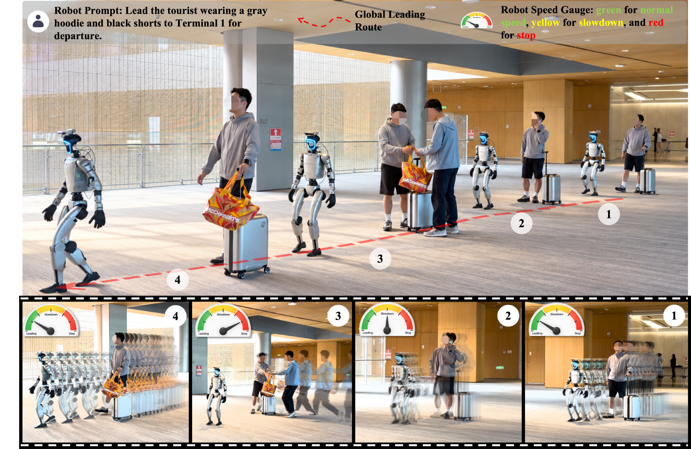

<h1>LeadVLA: Learning Follower-Aware Route Execution for Robot Leading</h1>

Tianle&nbsp;Zeng1 · Hanjing&nbsp;Ye1,2 · Bingyi&nbsp;Xia1 · Yuchen&nbsp;Zhou2 · Zibo&nbsp;Zhang3 · Yufei&nbsp;Huang2 · Yonggen&nbsp;Ling2 · Hong&nbsp;Zhang1

1 Southern University of Science and Technology 
2 Tencent Robotics X &nbsp; 3 Futian Laboratory

<!-- Add the arXiv paper link around this badge when the preprint is published. -->

  

## Release Roadmap

- [ ] Release model checkpoints.
- [ ] Release training code.
- [ ] Release LeadInfra simulation and data-generation tools.
- [ ] Release LeadBench benchmark and evaluation code.
