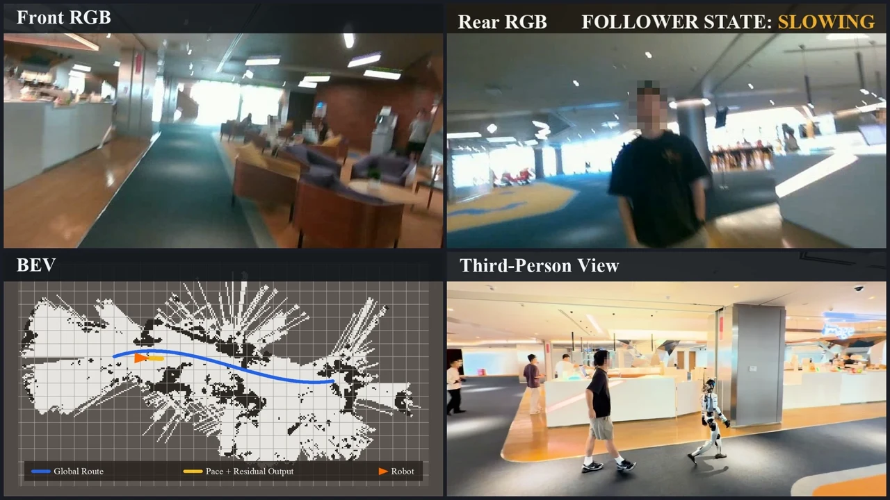
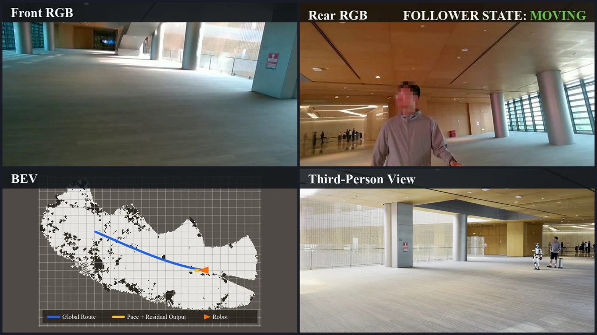
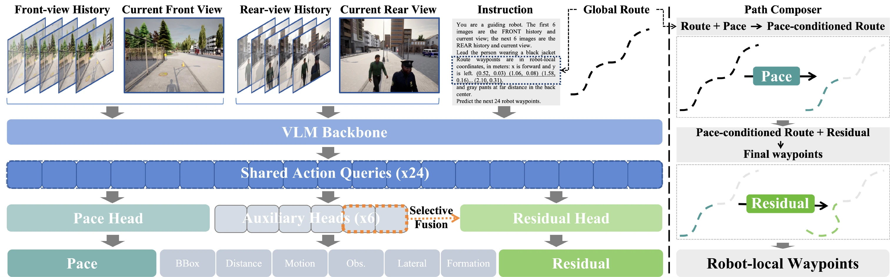
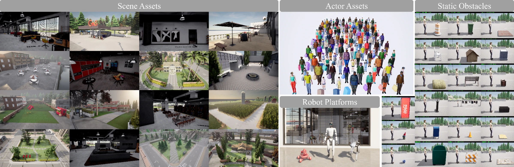

<h1>LeadVLA: Learning Follower-Aware Route Execution for Robot Leading</h1>

<strong>Keep the route. Learn how to adapt.</strong>

Tianle Zeng1 · Hanjing Ye1,2 · Bingyi Xia1 · Yuchen Zhou2 
Zibo Zhang3 · Yufei Huang2 · Yonggen Ling2 · Hong Zhang1

1 Southern University of Science and Technology 
2 Tencent Robotics X &nbsp; 3 Futian Laboratory

<a href="#overview">Overview</a> · <a href="#demos">Demos</a> · <a href="#method">Method</a> · <a href="#leadinfra--leadbench">LeadInfra &amp; LeadBench</a> · <a href="#citation">Citation</a>

> **Release status:** This repository currently contains the project overview and visual materials. We will progressively open-source model checkpoints, training code, LeadInfra, and LeadBench. See the [release roadmap](#release-roadmap) for planned deliverables. The arXiv link and BibTeX will be added once the preprint is available.

## Overview

**LeadVLA** is a vision-language-action policy for **follower-aware robot leading**. Given a planned route and a language instruction identifying whom to lead, the robot adapts its pace and local motion to the designated follower and the surrounding scene.

The project brings together three components:

| Component | Role |
| :--- | :--- |
| **LeadVLA** | A policy that combines a given **Path** with learned **Pace** and **Residual** to produce follower-aware robot motion. |
| **LeadInfra** | A simulation and data-generation infrastructure for diverse, closed-loop robot-leading interactions. |
| **LeadBench** | A closed-loop benchmark that measures route completion together with responsiveness to the designated follower. |

## Demos

Real-world robot leading in a coffee shop and an airport terminal. **Click a preview to explore the videos on our project page.**

<table>
  <tr>
    <td align="center" width="50%">
       
      <strong>Coffee shop</strong> 
      Adapting to a customer's movement along the route.
    </td>
    <td align="center" width="50%">
       
      <strong>Airport terminal</strong> 
      Guiding a designated traveler to the departure area.
    </td>
  </tr>
</table>

<a href="https://louiszengcn.github.io/LeadVLA_PAGE/#teaser"><strong>▶ Watch the overview video</strong></a> &nbsp; · &nbsp; <a href="https://louiszengcn.github.io/LeadVLA_PAGE/#leadinfra">Explore simulation scenarios</a>

## Method

  

LeadVLA processes front- and rear-view RGB history, the instruction, and route context in one multimodal forward pass. Its structured action representation separates three roles:

- **Path — where to go.** The planned route provides a stable guide.
- **Pace — how to progress.** Learned route-progress scaling lets the robot slow down, stop, resume, or speed up with the follower.
- **Residual — how to adjust locally.** Learned corrections adapt the paced route to the follower and nearby scene changes.

A deterministic **Path Composer** combines the given route with the predicted Pace and Residual to produce the final robot-local waypoints.

## LeadInfra & LeadBench

  

**LeadInfra** composes scenes, routes, robot embodiments, follower behaviors, formations, and distractors into closed-loop interactions. The infrastructure supports diverse robot-leading scenarios and supervision generated from how each interaction unfolds.

**LeadBench** evaluates robot leading across **Core, Easy, and Constrained** settings with both **single-person and multi-person** scenarios. It tests whether a policy can follow the route while continuing to respond to the designated follower.

<a href="https://louiszengcn.github.io/LeadVLA_PAGE/#leadinfra">Explore LeadInfra</a> &nbsp; · &nbsp; <a href="https://louiszengcn.github.io/LeadVLA_PAGE/#leadbench">Explore LeadBench</a> &nbsp; · &nbsp; <a href="https://louiszengcn.github.io/LeadVLA_PAGE/#results">View paper results</a>

## Release Roadmap

We plan to open-source the project in stages. **All implementation and model releases below are upcoming**; this initial repository provides an overview and demo previews.

| Stage | Planned release | Planned contents | Status |
| :---: | :--- | :--- | :---: |
| 1 | **Model checkpoints** | LeadVLA weights, model-loading instructions, and an inference example. | ⏳ Planned |
| 2 | **Training code** | Training pipeline, configurations, and data-preparation instructions. | ⏳ Planned |
| 3 | **LeadInfra** | Simulation and data-generation tools, scenario configuration, and setup documentation. | ⏳ Planned |
| 4 | **LeadBench** | Benchmark definitions, evaluation tools, metrics, and evaluation instructions. | ⏳ Planned |

Download links and usage documentation will be added here as each component becomes available. Release dates are not yet announced; the order and scope may be refined as we prepare the releases.

## Citation

If you find LeadVLA useful for your research, please consider citing our paper. The **arXiv link and BibTeX entry are coming soon** and will be added here after the preprint is published.
